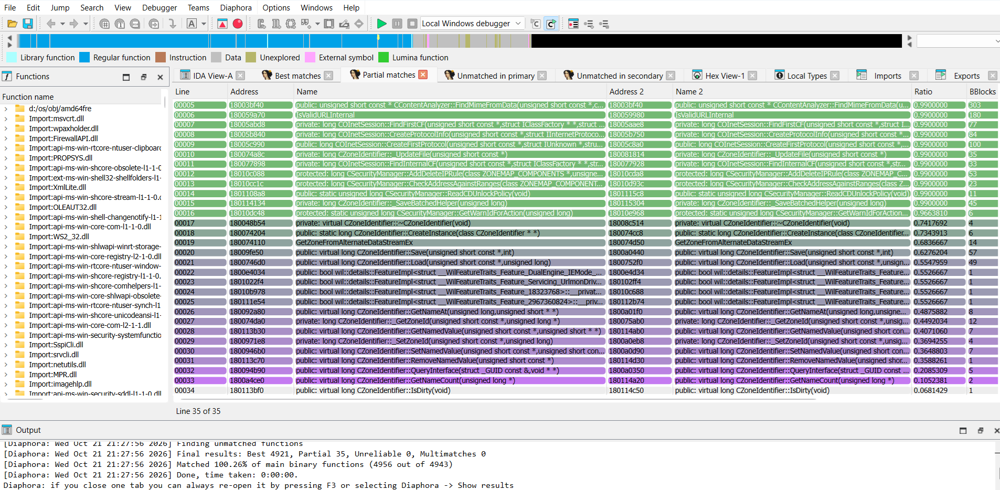
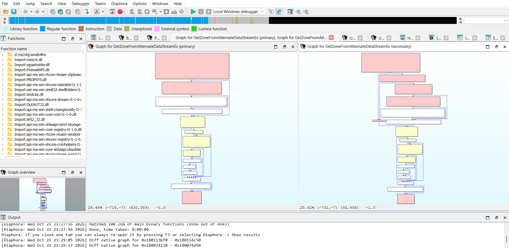

# Diaphora for IDA Free/Pro

Port of [joxeankoret/diaphora](https://github.com/joxeankoret/diaphora) (IDAPython) to the IDA C++ SDK, so it works in IDA Free/Pro 9.4+ without IDAPython (IDA Free does not have it). The SQLite database schema (version 3.4) and the SQL heuristics are those of the Python version. The port is based on Diaphora 3.4.1, commit [`de0eb92`](https://github.com/joxeankoret/diaphora/tree/de0eb920c1e54649bb3e7c4df5fa058b5c2cdc91) of the original repository.



> **Note:** So far the plugin has only been tested on Windows and with IDA Free.

> **IDA Pro users:** use the [original Diaphora](https://github.com/joxeankoret/diaphora) instead. It is actively maintained, and IDA Pro has IDAPython and the local Hex-Rays decompilers, so you get every feature: Python hooks, the machine learning model and the pseudo-code and microcode exports, heuristics and diffs. IDA Free's cloud decompiler gives plugins no access to the decompiler API, so in IDA Free this port works with assembly only.

Databases can be swapped with [diaphora-ghidra](https://github.com/Claude-Rays/diaphora-ghidra), the port for Ghidra, with limits. A diaphora-ghidra database works here if it was exported with its level 1 option off (locals named `v1`, `v2`...); with it on, this plugin crashes. In Ghidra, the databases of this plugin work but have no pseudo-code. What swapping gains is a second set of results: in our test, this plugin found 35 partial matches and diaphora-ghidra 20. Databases exported by the original Diaphora (IDA Pro) have not been tested.

## Build

Requirements (Windows):

- Visual Studio 2022 with the *Desktop development with C++* workload
- CMake ≥ 3.25 and Ninja (both ship with Visual Studio)
- The IDA SDK matching your IDA version (e.g. [HexRaysSA/ida-sdk](https://github.com/HexRaysSA/ida-sdk)), with the `IDASDK` environment variable pointing to it

```bat
set IDASDK=C:\path\to\ida-sdk
build.bat          :: incremental build
build.bat clean    :: build from scratch
```

`build.bat` loads the VS 2022 Developer Command Prompt (x64) and runs CMake + Ninja. The plugin ends up in `bin\diaphora.dll`, linked with the static CRT (`/MT`), so it does not need the VC++ redistributable.

SQLite: by default the plugin links against `winsqlite3.dll`, which ships with Windows 10/11, so there is nothing else to install. If you'd rather embed SQLite, drop `sqlite3.c` and `sqlite3.h` (the amalgamation) into `third_party/sqlite/` and rebuild.

## Install

Copy `diaphora.dll` to the `plugins` folder of your IDA installation (e.g. `C:\Program Files\IDA Free 9.4\plugins\`, needs admin) or to `%APPDATA%\Hex-Rays\IDA Pro\plugins\`.

## Usage

Everything is under the top-level **Diaphora** menu:

| Entry | What it does |
|---|---|
| Diff or export | Export dialog (same options as the original). Exports the IDB to SQLite and, if a second database is selected, diffs them |
| Show results (F3) | Reopens the result choosers |
| Load results / Save results | `.diaphora` files |
| Load and import results | Loads a `.diaphora` file and imports every `sub_*` match from the best and partial choosers |
| Import definitions | Imports TILs, structs, unions and enums from an exported database |
| Local diff | Diffs two functions of the current database (`extras/diaphora_local.py`) |
| Toggle dark mode colors | Switches the background colors of the diff viewers |

Typical workflow: export binary A to `A.sqlite`, open binary B, and in *Diff or export* pick `B.sqlite` as output and `A.sqlite` as the database to diff against.

Result choosers (*Best*, *Partial*, *Unreliable*, *Problematic*, *Unmatched in primary/secondary*, *Interesting matches*) have the original right-click menu: diff assembly / microcode / pseudo-code (side by side or as a patch), graph diffs, callers/callees graph, external tool, manual match, diff again, import selected / all, highlight. Double click jumps to the function. Delete removes the match.

*Diff assembly in a graph* on `GetZoneFromAlternateDataStreamEx`: the primary and secondary graphs docked side by side, with the modified blocks in yellow and the new ones in red:



### Batch modes (environment variables)

| Variables | Effect |
|---|---|
| `DIAPHORA_AUTO=1`, `DIAPHORA_EXPORT_FILE=x.sqlite` (optional `DIAPHORA_USE_DECOMPILER`, `DIAPHORA_FROM_ADDRESS`, `DIAPHORA_TO_ADDRESS`) | Export once the database is loaded, then quit |
| `DIAPHORA_AUTO_DIFF=1`, `DIAPHORA_DB1`, `DIAPHORA_DB2`, `DIAPHORA_DIFF_OUT` | Diff two databases, save the results, then quit (the command line mode of `diaphora.py`) |

IDA Free has no `-A` batch mode, so there IDA still shows its usual dialogs (load file, save database). The `DIAPHORA_*` overrides from the original also work: `DIAPHORA_UNRELIABLE`, `DIAPHORA_RELAXED_RATIO`, `DIAPHORA_SLOW_HEURISTICS`, `DIAPHORA_CPU_COUNT`, `DIAPHORA_SQL_TIMEOUT_LIMIT`, `DIAPHORA_MINIMUM_IMPORT_RATIO`, `DIAPHORA_DECOMPILER_PLUGIN`, `DIAPHORA_DEBUG`, …

## Mapping Python → C++

| Python | C++ |
|---|---|
| `diaphora_plugin.py` | `src/plugin.cpp` |
| `diaphora_ida.py`: `_diff_or_export`, `CBinDiffExporterSetup`, `BinDiffOptions`, `main()`, menu handlers | `src/commands.cpp` |
| `diaphora_ida.py`: `read_function`, `do_export`, `export_structures`, `export_til`, `CAstVisitor`, microcode | `src/exporter.cpp` |
| `diaphora_ida.py`: `get_modules_using_lfa`, `save_compilation_units`; `codecut/lfa.py`; `IDAMagicStrings.get_source_strings` | `src/compunits.cpp` |
| `diaphora_ida.py`: `import_*`, `do_import_one`, `import_instruction*` | `src/importer.cpp` |
| `diaphora_ida.py`: `CIDAChooser`, `CHtmlViewer`, `CHtmlDiff`, `CDiffGraphViewer`, `CCallGraphViewer`, `show_*`; `extras/diaphora_local.py` | `src/ui.cpp` |
| `diaphora.py`: `CBinDiff` (database, choosers data) | `src/bindiff.cpp` |
| `diaphora.py`: diffing engine (`diff`, heuristics runners, `check_ratio`, `deep_ratio`, multimatches, special heuristics, graphs) and `jkutils/threads.py` | `src/differ.cpp` |
| `diaphora.py`: `save_results`; `diaphora_ida.py`: `load_results`, `populate_choosers` | `src/results.cpp` |
| `diaphora_heuristics.py` | `src/heuristics_data.inc` (generated by `tools/gen_heuristics.py`), `src/heuristics.cpp` |
| `db_support/schema.py` | `src/bindiff.cpp` |
| `diaphora_config.py` | `src/config.hpp` |
| `scripts/patch_diff_vulns.py` | `src/vulns.cpp` (built in) |
| `jkutils/kfuzzy.py`, `others/tarjan_sort.py`, `get_cmp_asm*`, `get_cmp_pseudo_lines` | `src/algorithms.cpp` |
| `jkutils/factor.py`, `json`, `decimal`, `hashlib` | `src/util.cpp` |
| `difflib` (`SequenceMatcher`, `unified_diff`, `_mdiff`) | `src/difflib.cpp` |
| `sqlite3` module | `src/db.cpp` |
| `jkutils/graph_hashes.py` (KOKA) | `src/exporter.cpp` |

To regenerate the heuristics from a checkout of the original: `python tools/gen_heuristics.py C:\path\to\diaphora` (by default it looks for `..\diaphora`, next to this repository).

## Differences from the original

- **No Python.** Project-specific Python scripts (hooks) aren't supported. The default patch diffing script (`patch_diff_vulns.py`) is built in and kicks in automatically, like the original, when a patch diffing session is detected.
- **No machine learning model.** The scikit-learn `.pkl` model can't be loaded from C++, so the "Use an already trained model" option and the *ML matches* chooser are gone.
- **UI without Qt.** The IDA C++ SDK does not ship Qt headers, so:
  - HTML diffs are now custom viewers, with syntax highlighting through IDA's color tags. As in the HTML of the original, only the changed characters get a background: green for added, red for deleted, yellow for changed, each on its own side. IDA draws those backgrounds through `ui_get_lines_rendering_info`; a line background would cover the whole width of the window, both sides of a side-by-side diff at once. The colors are translucent, so they work with both the light and the dark themes (*Toggle dark mode colors* only makes them a bit stronger).
  - Result choosers: the rows are colored by ratio, as in the original. IDA paints a selected colored row in a light shade where the white text of the dark theme can't be read, and the selection and text colors can't be set from a plugin. So a row drops its color while it is selected, and IDA draws it with its normal selection colors.
  - Graph diffs use native graph viewers, docked side by side and zoomed to fit. Pan and zoom are not synced between the two.
- **MD-Index** is computed in `double`. Python uses `Decimal` with 28 digits, so the text in `md_index` can differ in the last digits from a database exported by the Python version. Diff databases exported with the same version of the plugin.
- **Decompiler:** the plugin tries `init_hexrays_plugin()` and, if that fails, loads `hexrays` or `hexx64`. IDA Free's cloud decompiler (`hexcx64`) gives plugins no access to the decompiler API, so in IDA Free (or without a decompiler) it exports assembly only: no pseudo-code or microcode, and no heuristics or diffs based on them.
- **No `-A` batch mode in IDA Free.** IDA Free can't run a database in batch mode, so:
  - the export and diff batch modes work, but IDA shows its usual dialogs (see [Batch modes](#batch-modes-environment-variables));
  - the HTML diff mode of the original (`DIAPHORA_AUTO_HTML` with `DIAPHORA_DIFF`, `DIAPHORA_EA1/EA2` and `DIAPHORA_HTML_ASM/PSEUDO`), which writes the assembly and pseudo-code diffs of two functions to HTML files from a batch run, was not ported.
- **No standalone diffing.** `python diaphora.py db1 db2` diffs two databases without IDA. Here diffing runs inside IDA, also from the `DIAPHORA_AUTO_DIFF` batch mode.
- **Configuration at build time.** `diaphora_config.py` is a Python file users can edit; here the values are compiled into `src/config.hpp`. As in the original, the most useful ones can still be overridden at runtime with `DIAPHORA_*` environment variables.
- Small fixes over the original: pseudo-code comments are saved on export too (the original cleared them before saving), import at instruction level orders the rows by side, and a renamed variable no longer shadows the imported name.

## License

Like the original, this port is released under the GNU AGPL v3; see [LICENSE](LICENSE). The parts ported from third-party code keep their notices in the source headers: kfuzzy (LGPL 2.1), CodeCut's Local Function Affinity (MIT, JHU/APL), Python's difflib (PSF License) and Paul Harrison's Tarjan sort.
